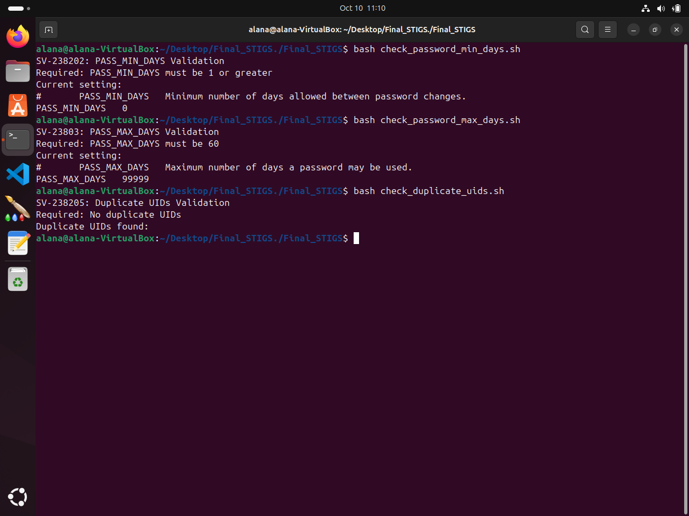
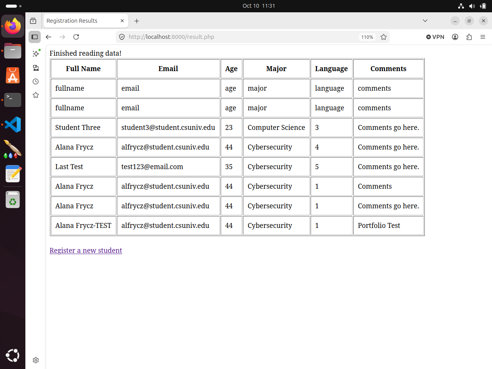

Portfolio
=========

Programming Projects
--------------------

### [Final_STIGs | CSCI 301](project1)

---

### [Student Registration System | CSCI 332](project2)

---

Ethics Paper
------------

### [Ethical Considerations of AI-Generated Evidence in Digital Forensics](pdf/Ethics Paper.pdf)

- **Class:** CSCI 301
- **Grade:** A

---

Page template forked from <a href="https://github.com/csu-cs/csci-portfolio">CSU-CS</a>

